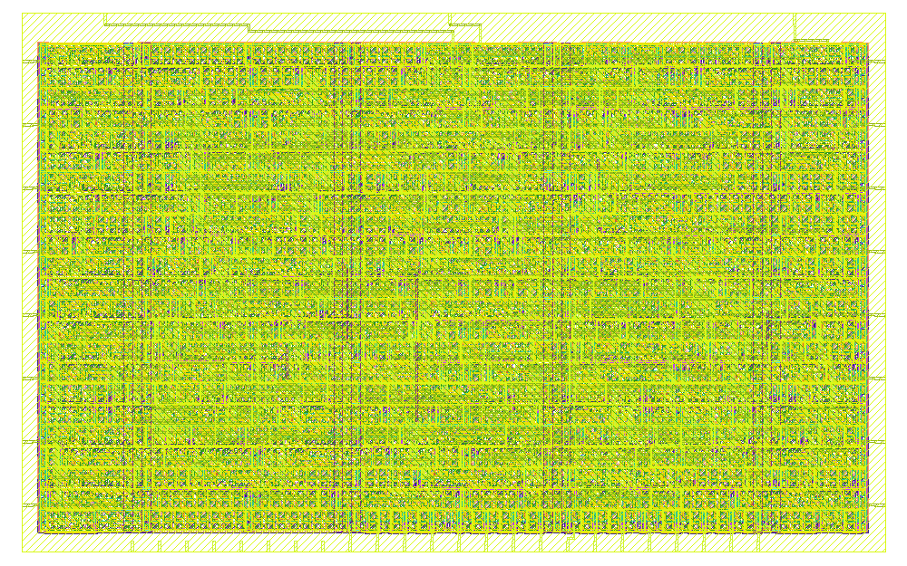

# Programmable Stepper Motor Controller

**IEEE Open Silicon Bootcamp 2026 · ASIC V2.0 Compact (E01) · GF180D, 180 nm**

A programmable digital controller for a **5 V 28BYJ-48 unipolar stepper motor**, implemented in Verilog-2001. The ASIC generates four phase-control signals for an **external ULN2003 driver**, with selectable direction, full-step or half-step operation, four stepping speeds, and continuous or finite motion.

The project demonstrates a complete digital design workflow from RTL and simulation to a compact physical macro. **ASIC V2.0 Compact is the primary Bootcamp candidate:** a 160 × 100 µm standalone macro validated at a 1 MHz clock frequency. Compact-outline acceptance, upper-level integration, density closure, physical motor testing, and fabrication authorization remain pending. **The compact ASIC is not approved for fabrication.**

## Explore the project

| Resource | Link |
| --- | --- |
| Project website | [GitHub Pages](https://leonardo-deleon.github.io/ttgf-stepper-motor-controller/) |
| Reviewed datasheet | [Datasheet PDF](https://leonardo-deleon.github.io/ttgf-stepper-motor-controller/datasheet.pdf) |
| Original layout image | [2D layout](https://leonardo-deleon.github.io/ttgf-stepper-motor-controller/layout.png) |
| Interactive 3D layout | [Tiny Tapeout GDS Viewer](https://gds-viewer.tinytapeout.com/?pdk=gf180mcuD&model=https%3A%2F%2Fraw.githubusercontent.com%2FLeonardo-DeLeon%2Fttgf-stepper-motor-controller%2F96a09e35f0a8f2d1d5ffa6009e07b15fe0397b87%2Fpreview%2Flayout.oas) |
| Layout and circuit exploration | [Tiny Tapeout Explorer](https://gds-explorer.tinytapeout.com/viewer?pdk=gf180mcuD&file=https%3A%2F%2Fraw.githubusercontent.com%2FLeonardo-DeLeon%2Fttgf-stepper-motor-controller%2F96a09e35f0a8f2d1d5ffa6009e07b15fe0397b87%2Fpreview%2Flayout.oas) |
| Physical design files | [Download GDSII](https://leonardo-deleon.github.io/ttgf-stepper-motor-controller/layout.gds) · [Download OASIS](https://leonardo-deleon.github.io/ttgf-stepper-motor-controller/layout.oas) |
| File integrity | [SHA-256 checksums](preview/SHA256SUMS) |
| Continuous integration | [GitHub Actions results](https://github.com/Leonardo-DeLeon/ttgf-stepper-motor-controller/actions) |

The two interactive viewer links reuse the original, commit-pinned E01 OASIS file. Explorer visualization is available; its E01 interactive simulation has the label-recognition limitation described below.

## Original compact layout

Original physical-design render from [E01 implementation run 45670862905](https://github.com/Leonardo-DeLeon/ttgf-stepper-motor-controller/actions/runs/45670862905), preserved in [preview/](preview/). The image is an actual layout render, not an artistic reconstruction. The GDSII, OASIS, PNG, and reviewed PDF retain their recorded checksums.

## Architecture

The design uses a single external **1 MHz clock**. A clock-enable timer advances the motor sequence without generating an additional clock domain. Commands pass through input synchronizers; direction, mode, speed, and distance are captured when a new move starts.

| RTL module | Responsibility |
| --- | --- |
| [`tt_um_ieee_bootcamp_stepper`](src/tt_um_ieee_bootcamp_stepper.v) | Tiny Tapeout interface, 1 MHz configuration, project enable, and pin mapping. |
| [`stepper_controller`](src/stepper_controller.v) | Input synchronization, command capture, and motion states: `WAIT_LOW`, `IDLE`, `MOVE`, `HOLD_LAST`, and `COMPLETE`. |
| [`clock_enable`](src/clock_enable.v) | Programmable step intervals of 10, 8, 6, or 4 ms. |
| [`step_counter`](src/step_counter.v) | Continuous operation or a finite count of 64–4096 electrical step transitions. |
| [`stepper_fsm`](src/stepper_fsm.v) | Forward/reverse phase sequencing, full-step/half-step selection, and coil release. |

The ASIC provides logic signals. The external ULN2003 supplies the motor-winding current from the motor supply. Wiring, logic-level compatibility, reset behavior, and the bench procedure are documented in [docs/info.md](docs/info.md).

## Motion control

### Full-step and half-step sequences

Patterns below are written in **IN1, IN2, IN3, IN4 order** and show the forward sequence (`DIR = 0`). Each sequence repeats while motion is active.

| Mode | Phase sequence |
| --- | --- |
| Two-phase full-step (`MODE = 0`) | `1100` → `0110` → `0011` → `1001` |
| Half-step (`MODE = 1`) | `1000` → `1100` → `0100` → `0110` → `0010` → `0011` → `0001` → `1001` |

Full-step operation energizes two phases at a time. Half-step operation alternates one and two energized phases. `DIR = 1` traverses the selected sequence in reverse. Actual clockwise/counterclockwise shaft motion depends on winding connections and viewing orientation.

### Speed and distance

| `SPEED[1:0]` | Step interval at 1 MHz | Electrical step transitions per second |
| --- | --- | --- |
| `00` | 10 ms | 100 |
| `01` | 8 ms | 125 |
| `10` | 6 ms | Approximately 166.67 |
| `11` | 4 ms | 250 |

| `DISTANCE[2:0]` | Command |
| --- | --- |
| `000` | Continuous motion while RUN remains high |
| `001` | 64 transitions |
| `010` | 128 transitions |
| `011` | 256 transitions |
| `100` | 512 transitions |
| `101` | 1024 transitions |
| `110` | 2048 transitions |
| `111` | 4096 transitions |

Distance counts electrical transitions after the initial phase pattern. It is an open-loop command, not measured shaft displacement; mechanical travel depends on stepping mode, gearing, load, and missed steps.

### Command lifecycle

1. Apply the clock, select the project (`ena = 1`), assert active-low reset, and hold RUN low. After releasing reset, keep RUN low for at least five clock edges.
2. Set direction, mode, speed, and distance. Keep these configuration bits stable for at least three clock periods before and after raising RUN.
3. Raise RUN. The controller captures the command, applies the initial phase pattern, asserts BUSY, and advances at the selected interval.
4. A finite move holds its final phase pattern for one additional interval, releases the coils, clears BUSY, and asserts DONE. Lower RUN to clear DONE and rearm.

Lowering RUN during motion stops the move and releases the coils without asserting DONE. Reset or project disable clears the phase and status outputs. After reset or re-enable, the controller must observe RUN low before accepting another command. Changing the configuration during a move does not reprogram the active command.

## Inputs and outputs

The top-level module is `tt_um_ieee_bootcamp_stepper`. The authoritative pin mapping is in [info.yaml](info.yaml) and the [RTL wrapper](src/tt_um_ieee_bootcamp_stepper.v).

| Port | Direction | Signal | Function |
| --- | --- | --- | --- |
| `clk` | Input | Clock | External 1 MHz clock. |
| `rst_n` | Input | Reset | Active-low reset. |
| `ena` | Input | Project enable | Low disables the controller and aborts the current command. |
| `ui_in[0]` | Input | RUN | Start after a low-to-high command; low stops or rearms. |
| `ui_in[1]` | Input | DIR | `0`: forward; `1`: reverse. |
| `ui_in[2]` | Input | MODE | `0`: two-phase full-step; `1`: half-step. |
| `ui_in[4:3]` | Input | SPEED[1:0] | Interval selection; bit 3 is SPEED0. |
| `ui_in[7:5]` | Input | DISTANCE[2:0] | Continuous/finite selection; bit 5 is DISTANCE0. |
| `uo_out[0]` | Output | IN1 | Active-high phase control to external driver input 1. |
| `uo_out[1]` | Output | IN2 | Active-high phase control to external driver input 2. |
| `uo_out[2]` | Output | IN3 | Active-high phase control to external driver input 3. |
| `uo_out[3]` | Output | IN4 | Active-high phase control to external driver input 4. |
| `uo_out[4]` | Output | BUSY | High during motion and the final hold interval. |
| `uo_out[5]` | Output | DONE | High after a finite move completes; cleared when RUN low is observed. |
| `uo_out[7:6]` | Output | Reserved | Tied low. |
| `uio_in[7:0]` | Input | Unused | Bidirectional pads remain in input mode: `uio_oe = 0`; `uio_out = 0`. |

## ASIC V2.0 Compact: measured results

These results describe the **E01 standalone macro** and its archived verification evidence. They do not constitute shuttle integration or fabrication approval.

| Metric | Verified result | Evidence |
| --- | --- | --- |
| Process | GF180D, 180 nm (`gf180mcuD`) | [Implementation manifest](experiments/stage5/manifest.json) |
| Clock frequency / period | 1 MHz / 1000 ns | [RTL wrapper](src/tt_um_ieee_bootcamp_stepper.v) · [Implementation configuration](experiments/stage5/config.json) |
| Total macro dimensions | 160 × 100 µm | [Physical implementation][implementation] |
| Geometric outline area | 16,000 µm² | 160 × 100 µm |
| Functional and auxiliary cell area | 9,988.16 µm² | [Physical implementation][implementation] · [Area audit](experiments/stage5/compact_audit.py) |
| Flip-flops | 61 | [Physical implementation][implementation] |
| Physical instances, including physical-only cells | 853 | [Physical implementation][implementation] |
| RTL regression | 198/198 checks passed across six Verilog benches | [RTL run][rtl] |
| Cocotb wrapper tests | 2/2 passed | [RTL run][rtl] |
| Functional Gate Level tests | 2/2 passed | [Independent signoff][signoff] |
| Extracted timing and electrical checks | Nine corners; no setup, hold, maximum slew, or maximum capacitance violations | [Physical implementation][implementation] · [Independent signoff][signoff] |
| Geometric DRC | 0 violations | [Independent signoff][signoff] |
| LVS | Circuits match uniquely | [Physical implementation][implementation] · [Independent signoff][signoff] |
| Antenna | 0 violations | [Independent signoff][signoff] |
| GDSII / OASIS geometric equivalence | Zero geometric XOR differences across 24 layer/datatype pairs | [Independent signoff][signoff] |
| Standalone density | **5 open violations:** M2.4, M3.4, M4.4, M5.4, MT.3 | [Independent signoff][signoff] |

The nine corners combine `nom`, `min`, and `max` extracted interconnect conditions with `tt_025C_3v30`, `ss_125C_3v00`, and `ff_n40C_3v60`. Timing is evaluated at the specified 1 MHz operating point.

The functional and auxiliary area excludes filler/decap, tap, and endcap cells. It is distinct from the 16,000 µm² geometric outline. Zero **geometric** DRC violations does not mean density closure: the five density findings remain open. The signoff workflow explicitly reports `macro_checks_passed_upper_level_review_pending`.

The [signoff manifest](experiments/stage5/signoff-manifest.json) records the original implementation run, artifact identities, tool versions, and view hashes. The [published checksums](preview/SHA256SUMS) identify the exact downloadable streams, render, and PDF.

## Implementation status and preserved versions

| Implementation | Dimensions | Role and status |
| --- | --- | --- |
| **ASIC V1.1** | 346.64 × 160.72 µm | Official GF180D reference and backup. [Official flow and Precheck][v11] passed **12/12** checks. The project reports a previously passed basic functional demonstration in Tiny Tapeout Explorer. |
| **ASIC V2.0 Compact (E01)** | 160 × 100 µm | Validated standalone macro and **primary Bootcamp candidate**, with the evidence and outstanding integration work listed here. V1.1's official Precheck result does not transfer to this compact outline. |

**Explorer limitation for E01:** interactive simulation is limited by recognition of the compact macro's **Metal2 and Metal3 pin labels**. Loading and viewing the geometry does not establish a successful interactive functional demonstration. E01 functional evidence comes from the RTL, cocotb, and Gate Level runs linked above. The existing GDSII and OASIS files are preserved without relabeling.

The repository retains all four branches:

| Branch | Purpose |
| --- | --- |
| [`main`](https://github.com/Leonardo-DeLeon/ttgf-stepper-motor-controller/tree/main) | ASIC V1.0 historical reference. |
| [`experiment/stage4a-electrical`](https://github.com/Leonardo-DeLeon/ttgf-stepper-motor-controller/tree/experiment/stage4a-electrical) | ASIC V1.1 official GF180D backup. |
| [`experiment/stage5-compact`](https://github.com/Leonardo-DeLeon/ttgf-stepper-motor-controller/tree/experiment/stage5-compact) | Validated ASIC V2.0 Compact implementation and signoff. |
| [`experiment/stage6-bootcamp-preview`](https://github.com/Leonardo-DeLeon/ttgf-stepper-motor-controller/tree/experiment/stage6-bootcamp-preview) | Primary ASIC V2.0 Compact presentation, datasheet, and visualization. |

## Outstanding work before fabrication

- Acceptance of the **160 × 100 µm compact outline** for the intended integration.
- **Upper-level integration** and verification in that context.
- Resolution and review of the **five density violations**: M2.4, M3.4, M4.4, M5.4, and MT.3.
- **Physical motor and breakout tests**, including driver compatibility and measured motion.
- Explicit **fabrication authorization** after the required reviews.

The `tiles: "1x1"` value in the datasheet metadata identifies the standard GF180D documentation schema. It is not acceptance of the compact outline. No submission, payment, or manufacturing authorization is implied by this repository or its successful CI runs.

## CI and publication behavior

| Workflow | Trigger and scope on the presentation branch |
| --- | --- |
| [`test`](.github/workflows/test.yaml) | Push: cocotb wrapper tests and the six Verilog benches. |
| [`docs`](.github/workflows/docs.yaml) | Push: documentation checks and a datasheet PDF artifact. |
| [`E01 layout preview`](.github/workflows/viewer.yaml) | Push: checksum verification and archiving of the existing preview files. |
| [`E01 GitHub Pages`](.github/workflows/pages-e01.yaml) | Push: verifies and stages the existing site files. Upload and deployment require `BOOTCAMP_PAGES_SHA` to equal the exact commit SHA. |
| [`E01 compact 160x100`](.github/workflows/e01-compact.yaml) | Manual dispatch only; execution restricted to `experiment/stage5-compact`. |
| [`E01 compact independent signoff`](.github/workflows/gds.yaml) | Manual dispatch only; execution restricted to `experiment/stage5-compact`. |

A README-only push does not start a new hardening run. This presentation update does not set or reactivate `BOOTCAMP_PAGES_SHA`; the existing Pages deployment is retained.

## License and attribution

See the [Apache 2.0 license](LICENSE) and the preview [attribution notice](preview/NOTICE). The current datasheet credit, “IEEE Open Silicon Bootcamp 2026 Team,” is provisional and awaiting confirmation. The project uses the Tiny Tapeout GF180 template and tooling identified in its manifests and workflows.

[implementation]: https://github.com/Leonardo-DeLeon/ttgf-stepper-motor-controller/actions/runs/45670862905
[rtl]: https://github.com/Leonardo-DeLeon/ttgf-stepper-motor-controller/actions/runs/45735028642
[signoff]: https://github.com/Leonardo-DeLeon/ttgf-stepper-motor-controller/actions/runs/45702521852
[v11]: https://github.com/Leonardo-DeLeon/ttgf-stepper-motor-controller/actions/runs/45643418859
